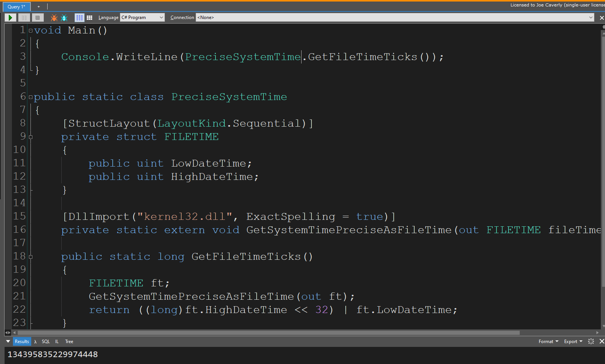
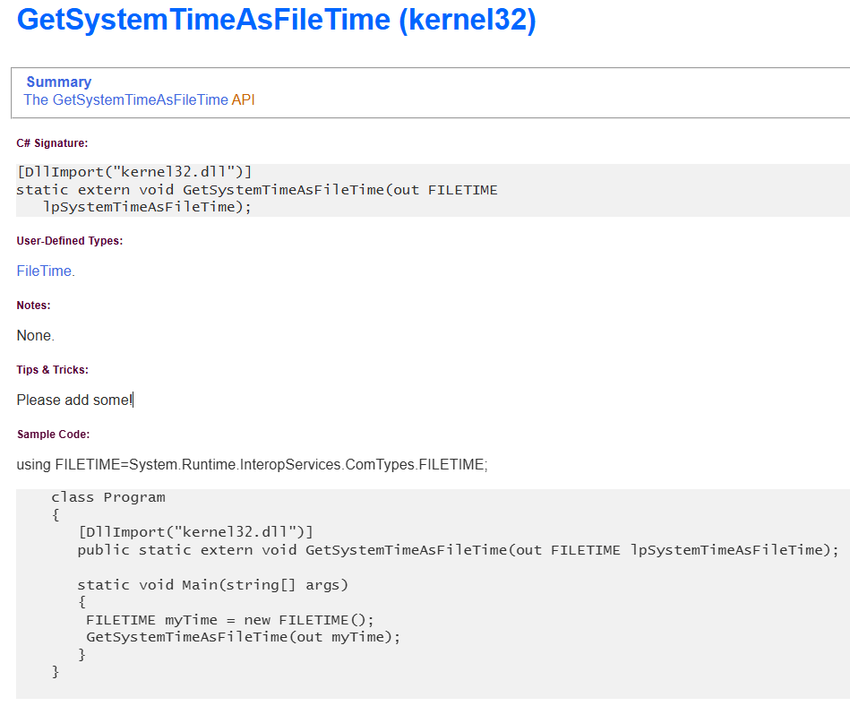

# GetSystemTimePreciseAsFileTime
  
In a recent discussion within the JPSoftware support forum...

https://jpsoft.com/forums/threads/winapi-with-pint64-gives-only-the-high-dword.13517/post-78206

...I demonstrated a method of invoking the **GetSystemTimePreciseAsFileTime** Windows API via a PowerShell 5.1 script.
  
Here's how I developed that solution.

I started out using LINQPad 5 to test the required C# code, since C# code is how PowerShell 5.1 accesses the Windows API.

  
  
I purchased LINQPad 5 back in 2022, as the author, Joseph Albahari, also wrote the book C# 5.0 in a Nutshell.

(I've since upgraded to his book to C# 7.0 in a Nutsell).

**pinvoke.net** did not have the signature for **GetSystemTimePreciseAsFileTime**, but it did have **GetSystemTimeAsFileTime**, which I used as my starting point.

https://pinvoke.net/default.aspx/kernel32.GetSystemTimeAsFileTime



Once I had the C# Code working in LINQPad 5, I wrapped the C# Code inside my PowerShell 5.1 script;

```powershell
if (-not ('PreciseSystemTime' -as [type])) {
    Add-Type -TypeDefinition @'
using System;
using System.Runtime.InteropServices;

public static class PreciseSystemTime
{
    [StructLayout(LayoutKind.Sequential)]
    private struct FILETIME
    {
        public uint LowDateTime;
        public uint HighDateTime;
    }

    [DllImport("kernel32.dll", ExactSpelling = true)]
    private static extern void GetSystemTimePreciseAsFileTime(out FILETIME fileTime);

    public static long GetFileTimeTicks()
    {
        FILETIME ft;
        GetSystemTimePreciseAsFileTime(out ft);
        return ((long)ft.HighDateTime << 32) | ft.LowDateTime;
    }
}
'@
}

$ticks = [PreciseSystemTime]::GetFileTimeTicks()

$ticks
```
I can then call the C# Code from TCC via the **PShell** command;

```powershell
echo %{pshell GetSystemTimePreciseAsFileTime.ps1} 
134394848605158668

echo %@eval[%{pshell GetSystemTimePreciseAsFileTime.ps1}=h]
1DD77671ACCCE74
```
After I was sure that the script worked correctly, I gave it to DuckAI for code formatting.
  
I use LINQPad 5 for testing routines for the C# Plugins that I have created, for example...

**jlcUtils** 
https://github.com/joec4281/jlcUtils/blob/main/jlcutils.cs  
  
**CsScript**
https://github.com/joec4281/CSScript/blob/main/CsScript.cs

I also use DuckAI for code formatting.

Joe 